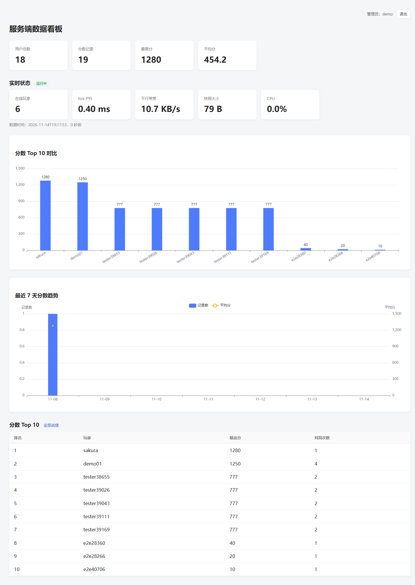
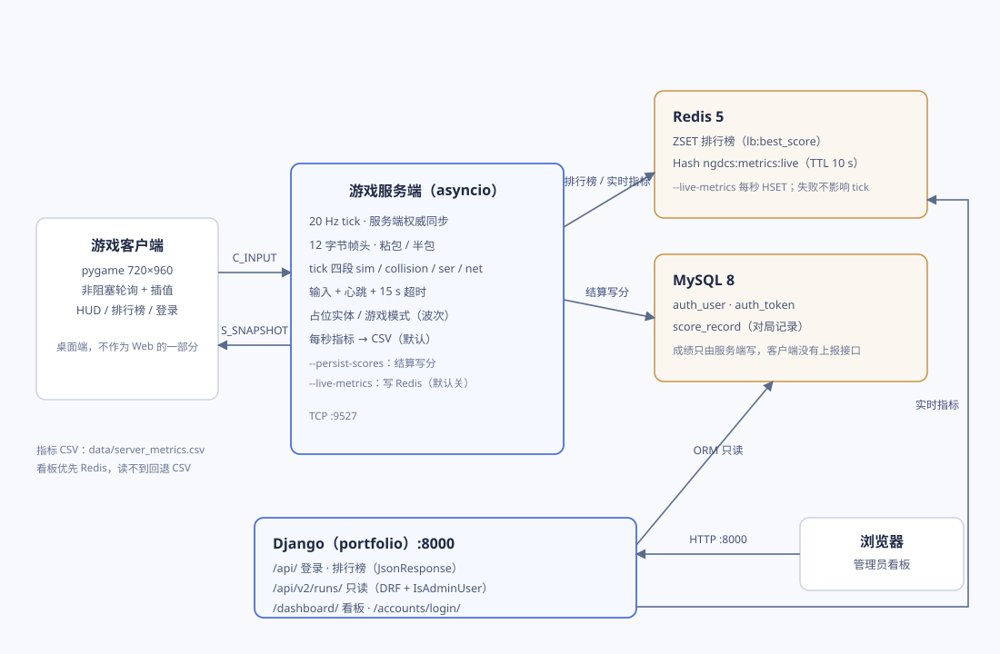
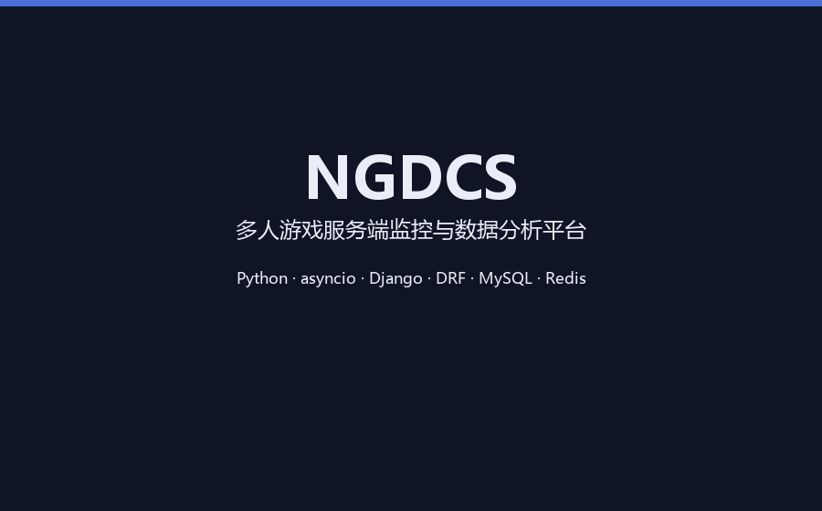
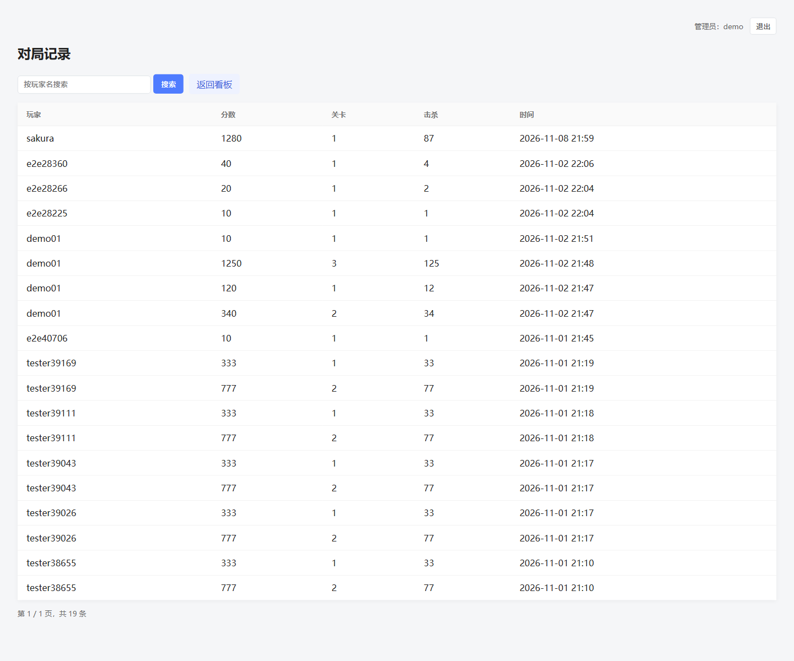
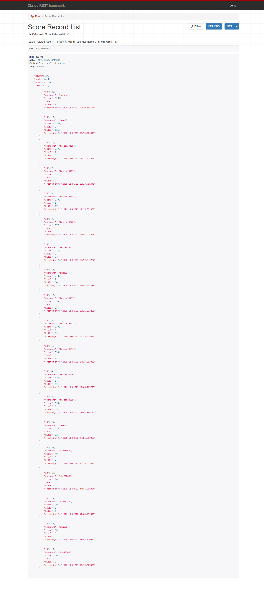

# NGDCS · 多人游戏服务端监控与数据分析平台

> 一个 C/S 实时游戏服务端 + 一个只读的监控 / 复盘看板：服务端 20 Hz 广播、客户端插值渲染，看板把"跑起来之后发生了什么"变成实时指标、对局记录和趋势图。





**功能**

- 自定义二进制协议：12 字节帧头，解决 TCP 粘包 / 半包，四类快照条目逐字节对齐
- asyncio 服务端：20 Hz tick、服务端权威运动、输入 + 心跳 + 超时
- 数据采集：每秒一行 CSV（tick 四段、快照体积、流量、CPU），黄金基线锁默认实验路径
- 只读看板：登录 / 权限、实时指标（Redis → CSV 回退）、Top 10、7 天趋势、对局记录分页搜索
- 只读 API：`/api/v2/runs/`（DRF，ModelSerializer + ViewSet + 分页 / 搜索 / 排序 + 管理员权限）

**技术栈**

`Python 3.13` · `asyncio` · `pygame` · `Django 5.2` · `DRF` · `MySQL 8` · `Redis` · `Docker Compose` · `nginx` · `unittest`

---

## 目录

- [项目是什么](#项目是什么)
- [架构](#架构)
- [功能](#功能)
- [技术栈](#技术栈)
- [演示](#演示)
- [截图](#截图)
- [快速开始](#快速开始)
- [测试](#测试)
- [接口](#接口)
- [目录结构](#目录结构)
- [部署（可选）](#部署可选)

---

## 项目是什么

| 部分 | 角色 | 技术 |
|---|---|---|
| 游戏服务端 + 客户端 | 被观测对象 | Python 3.13 · asyncio · 自定义二进制协议 · pygame |
| 监控与数据分析看板 | 观测者 | Django 5.2 · DRF · MySQL 8 · Redis |

服务端每 50 ms 广播一次全量快照，客户端只上报按键意图、坐标由服务端算；
每秒把 tick 耗时、快照体积、收发流量、CPU 落成一行 CSV。
看板只读这些数据：实时指标、对局记录、Top 10、7 天趋势。

**核心论点**：通信层不是瓶颈 —— E9 实验中通信占比从 73.0%（64 实体）降到 6.7%（2254 实体），
单核 50% 的拐点约在 215 敌机 / 1720 子弹。

---

## 架构

- **长短连接分层**（D-005）：HTTP 负责登录 / 排行榜 / 看板，TCP 负责实时对局。
- **服务端权威**：客户端只发 `C_INPUT` 按键位，坐标由服务端计算，客户端无法伪造位置。
- **快照即全量真相**（D-012）：不做事件同步，靠 20 Hz 全量帧 + 客户端插值。
- **看板只读**：不改协议、不改 tick 逻辑；Redis 读不到就回退 CSV 最后一行。

---

## 功能

### 实时通信
- 12 字节帧头（magic / version / type / seq / length），处理粘包、半包、超大包
- asyncio 服务端：20 Hz tick、输入保质期、心跳与 15 s 超时
- 四类快照条目：玩家 / 敌机 / 子弹 / 道具，字节数与协议文档逐字节对齐
- 压测机器人：观察者模式、输入模式、心跳与指标汇总

### 数据采集与实验
- 每秒一行 CSV：tick 四段（sim / collision / ser / net）、快照体积、收发流量、CPU、内存
- 黄金基线：200 帧 SHA256 + 精确坐标，锁住默认实验路径
- 实验回归：`tools/check_experiments` 硬校验 13 项 + 软校验 11 项

### 看板
- 登录 / 权限（仅 staff）、对局记录分页与按玩家名搜索
- Top 10、7 天趋势、实时指标（在线人数 / tick P95 / 带宽 / 快照大小 / CPU）
- 实时指标优先读 Redis（`ngdcs:metrics:live`，TTL 10 s），读不到回退 CSV 最后一行

---

## 技术栈

| 层 | 选型 | 说明 |
|---|---|---|
| 实时服务端 | Python 3.13 + asyncio | 单线程事件循环，20 Hz tick |
| 协议 | 自定义二进制 | 12 字节帧头；E1 实测比 JSON 小 4.7 倍 |
| 客户端 | pygame | 720×960，非阻塞 socket + 一帧插值 |
| Web | Django 5.2 + DRF | 纯 Django JSON 接口 + 一个 DRF 只读资源 |
| 数据库 | MySQL 8 | `auth_user` / `auth_token` / `score_record` |
| 缓存 | Redis | 排行榜 ZSET + 实时指标 Hash |
| 部署 | Docker Compose + nginx + gunicorn | 可选，见[部署](#部署可选) |

---

## 演示



流程：启动服务端 → 管理员登录 → 看板实时指标 / 趋势 / Top 10 → 对局记录 → `/api/v2/runs/`。

> GIF 录制于本地真实运行（6 个机器人连服务端、Redis 实时指标、MySQL 真实数据），**不是云端演示**。
> 视频文件在 `docs/demo/`，体积约 0.8 MB；如果不想让仓库变大，可上传到 GitHub Release 后把这里换成链接。

---

## 截图

| 看板总览 | 对局记录 |
|---|---|
|  |  |

DRF 只读接口（管理员会话下的 Browsable API）：



更多游戏端截图在 `docs/screenshots/`。

---

## 快速开始

### 前置
- Python 3.13
- MySQL 8（库 `myproject`）
- Redis 5+（可选：排行榜与实时指标；没有也能跑，看板回退 CSV）

### 配置
```powershell
cd E:\PythonProject
copy .env.example .env
# 编辑 .env：
#   NGDCS_SECRET_KEY=<随机串>
#   NGDCS_DB_PASSWORD=<本地 MySQL 密码>
#   NGDCS_DEBUG=1
```

> `.env` 不进仓库（`.gitignore`），密钥只从环境变量 / `.env` 读，代码里没有默认密钥。

### 启动
```powershell
# 1) 依赖（务必带镜像源）
.\.venv\Scripts\python.exe -m pip install -r requirements.txt `
    -i https://pypi.tuna.tsinghua.edu.cn/simple --no-cache-dir --progress-bar off

# 2) 建表
.\.venv\Scripts\python.exe -X utf8 manage.py migrate

# 3) 建管理员（或灌演示数据，见下）
.\.venv\Scripts\python.exe -X utf8 manage.py createsuperuser

# 4) Django（8000 只能有一个）
.\.venv\Scripts\python.exe -X utf8 manage.py runserver 127.0.0.1:8000

# 5) 游戏服务端（另开窗口）
.\.venv\Scripts\python.exe -X utf8 -m server.main --game-mode --persist-scores

# 6) 客户端（另开窗口）
.\.venv\Scripts\python.exe -X utf8 -m client.main
```

打开 <http://127.0.0.1:8000/dashboard/>，用管理员账号登录。

**实时指标**（可选）：Redis 在跑时给服务端加 `--live-metrics`：

```powershell
.\.venv\Scripts\python.exe -X utf8 -m server.main --game-mode --persist-scores --live-metrics
```

### 演示数据（可选）

```powershell
$env:DEMO_PASSWORD = "自己设一个"
.\.venv\Scripts\python.exe -X utf8 manage.py seed_demo
```

生成 `demo` 管理员（staff）+ 5 个 `demo_` 玩家 + 35 条对局（铺在最近 7 天）。
**幂等**：重复跑会重建而不是累加。密码只从 `DEMO_PASSWORD` 读，不写死、不打印。

> 一键脚本：`tools\start_game.bat`（服务端 + Django + 客户端），
> `tools\start_dashboard.bat`（只起 Django 看板，带 `/dashboard/` 状态码检查）。

---

## 测试

```powershell
# 主测试（协议 / 服务端 / 机器人 / 实验回归 / 指标）
.\.venv\Scripts\python.exe -X utf8 -m unittest discover -s tests

# Django 测试（账号 / 看板 / DRF 接口 / 演示数据）
.\.venv\Scripts\python.exe -X utf8 manage.py test accounts dashboard --noinput

# 黄金基线（SHA 必须不变）
.\.venv\Scripts\python.exe -X utf8 -m unittest tests.test_golden_baseline

# 实验回归（硬 13 + 软 11）
.\.venv\Scripts\python.exe -X utf8 -m tools.check_experiments
```

当前结果：

```text
主测试        491 passed
Django        52 passed（46 + 6 个 seed_demo 测试）
黄金基线      SHA256 7860bdb9…（默认实验路径未变）
实验回归      24/24
```

---

## 接口

| 方法 | 路径 | 权限 | 说明 |
|---|---|---|---|
| POST | `/api/auth/register` | 公开 | 注册并发 token |
| POST | `/api/auth/login` | 公开 | 登录 |
| GET | `/api/leaderboard` | 公开 | 排行榜（Redis 优先，MySQL 兜底） |
| GET | `/api/v2/runs/` | 管理员 | 对局记录：分页 / `search` / `ordering` |
| GET | `/api/v2/runs/<id>/` | 管理员 | 单条对局 |

```text
GET /api/v2/runs/?page=2&page_size=50&search=demo&ordering=-score
```

匿名访问 `/api/v2/runs/` 返回 403（SessionAuthentication 不返回 `WWW-Authenticate`，所以不是 401）。

---

## 目录结构

```text
protocol/    12 字节帧、快照编解码、编码器（binary / binary_fast / json）
server/      asyncio 服务端、实体、运动学、指标 CSV、实时指标 Redis 发布器
client/      pygame 客户端（渲染 / 插值 / 输入 / 心跳）
bot/         压测机器人（观察者 / 输入 / 心跳）
accounts/    用户、token、成绩、排行榜、DRF 只读接口（api.py）、seed_demo
dashboard/   只读看板（视图 / 模板）
webapp/      Django 配置与路由
tools/       实验跑批、出图、回归检查、截图 / 录屏
tests/       主测试套件（491）
docs/        架构图、截图、实验记录
deploy/      nginx 配置、容器入口脚本
```

---

## 部署（可选）

> **本项目没有上线**，也不要求上云。下面的 Compose 只用于本地一键起环境。

```bash
cp .env.example .env      # 改 SECRET_KEY / MySQL 密码
docker compose up -d --build

# 可选：灌演示数据（幂等）
docker compose exec web python manage.py seed_demo
```

服务：MySQL 8、Redis 7、Django（gunicorn）、nginx。

- 对外只暴露 **80**；3306 / 6379 只绑 `127.0.0.1`
- 静态文件由 nginx 从 `collectstatic` 的卷直接提供
- 配置项全部走环境变量（`.env.example` 有清单）
- 详细上线步骤见 `docs/16-部署清单.md`
